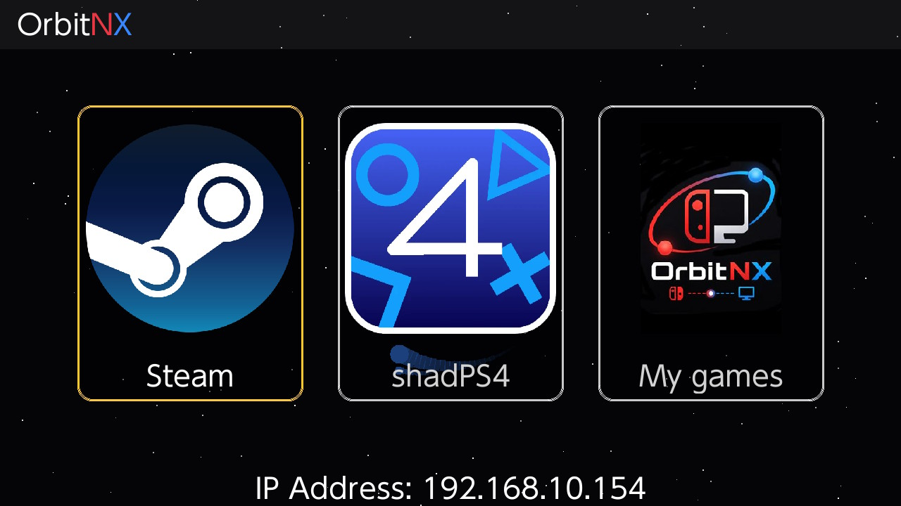

**Русский** | [English](README.en.md)

# OrbitNX

Стриминг игр с Windows-ПК на Nintendo Switch по локальной сети: картинка и звук идут с компьютера
на консоль, а управление с Joy-Con, Pro Controller и сенсорного экрана — обратно на компьютер.

Проект состоит из двух частей:

- **OrbitNX** — приложение для Windows (`OrbitNX/`). Запускает игру, захватывает изображение и звук и
  передаёт их на Switch, а нажатия кнопок превращает в виртуальный геймпад.
- **OrbitNX для Switch** — homebrew-приложение (`Client/`). Показывает поток и отправляет ввод.

## Возможности

- **Steam Big Picture** — весь ваш Steam с геймпада.
- **shadPS4** — эмулятор PlayStation 4, с гироскопом через виртуальный DualShock 4.
- **Своя библиотека игр** — обычные игры (`.exe`), игры Steam, эмуляторы и собственные скрипты запуска,
  с обложками в меню Switch.
- До 4 геймпадов, сенсорный экран Switch работает как касания на ПК.
- Аппаратное кодирование NVIDIA NVENC и аппаратное декодирование на Switch.
- Кнопка Steam на Switch: **«−» + «+»**. Возврат в меню: удерживать **«−» 3 секунды**.

## Документация

- [Возможности](docs/features.md) — как выглядит система и всё, что умеет OrbitNX, со скриншотами
- [Установка](docs/installation.md) — что нужно на ПК и на Switch
- [Использование](docs/usage.md) — подключение, режимы, управление, настройки
- [Библиотека игр](docs/library.md) — свои игры, обложки, захват окна
- [Решение проблем](docs/troubleshooting.md) — чёрный экран, артефакты, нет связи, логи
- [Как это устроено](docs/architecture.md) — компоненты, сетевые порты и протокол

Для разработчиков — сборка из исходников: [DEVELOPMENT.md](DEVELOPMENT.md).

## Разработка

Проект разрабатывался вместе с [Claude Code](https://claude.com/claude-code) — ИИ-ассистентом
для программирования от Anthropic.

## Лицензия

[GPL-3.0](LICENSE). Используемые сторонние компоненты и их лицензии перечислены в
[THIRD-PARTY-NOTICES.md](THIRD-PARTY-NOTICES.md).
