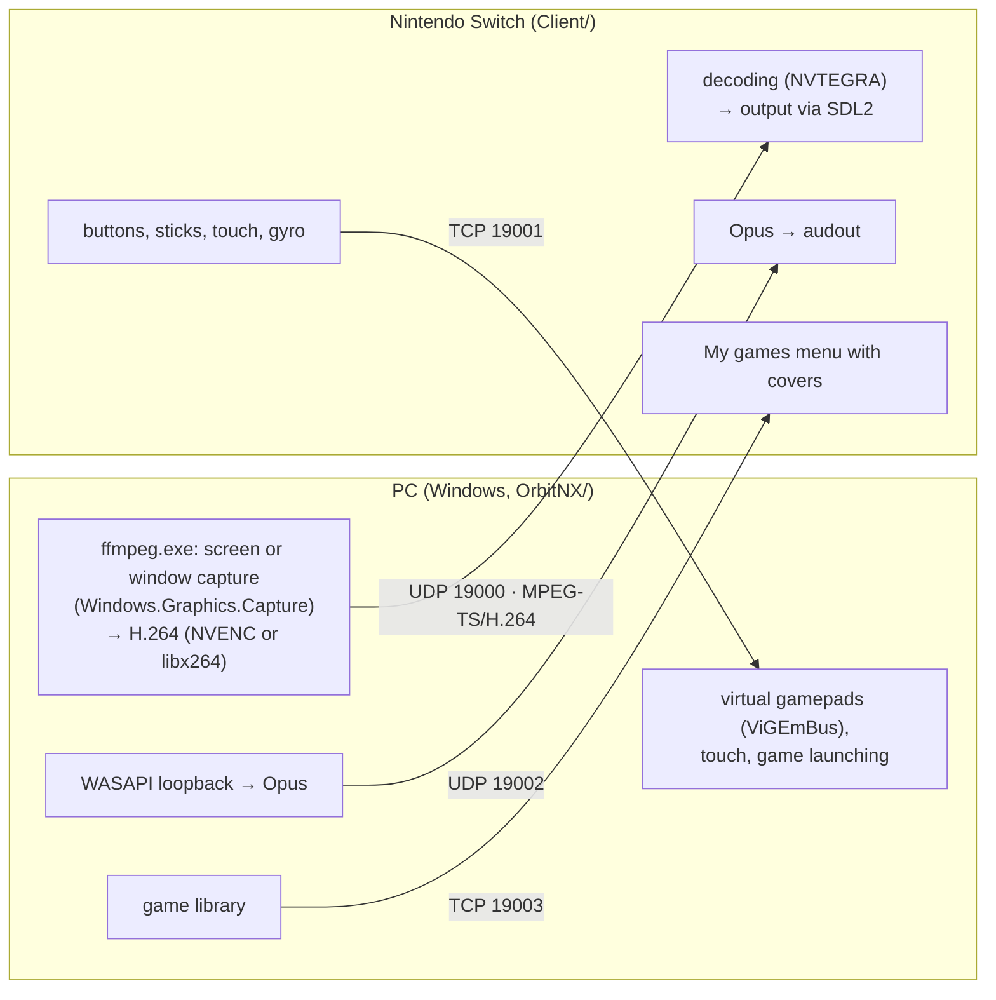

[Русский](architecture.md) | **English**

# How it works

## Components

The PC opens all TCP connections: the Switch only listens on its ports, so the PC doesn't need to
accept incoming connections. Video, audio and input are three independent streams with no shared
synchronization.

## PC: OrbitNX (`OrbitNX/`)

C#, .NET 10, WPF user interface.

- `AppOrchestrator.cs` is the center of the app: when a session starts or ends, it starts and stops
  capture, audio, gamepads and the selected app.
- `Session/`: the connection to the Switch over the HID port; a session starts with the first input
  packet. Adaptive bitrate.
- `Capture/VideoEncoder.cs` manages the `ffmpeg.exe` process.
- `Audio/`: audio capture, Opus encoding, packing into RTP-like packets.
- `Input/`: input packet parsing, Xbox 360 / DualShock 4 virtual gamepads, the Steam button
  gesture, touch.
- `BigPicture/`: starting Steam and Big Picture, tracking the running game.
- `Library/`: the game library: storage, launching every game type, sending the list and covers to
  the Switch.
- `ShadPs4/`: starting shadPS4.
- `Native/`: Windows helpers: child processes, game process tracking, window geometry.

OrbitNX doesn't inject anything into game processes or read their memory: games are only launched,
and OrbitNX watches them with minimal access rights. This matters for games with anti-cheat.

## Switch: client (`Client/`)

C, devkitPro / libnx.

- `main.c`: startup, threads, the "menu → streaming → menu" loop.
- `network/`: accepting the input connection, packet format.
- `video/`: receiving and hardware-decoding video (separate decode and output threads).
- `audio/`: receiving and playing audio.
- `input/`: reading gamepads, touch screen and gyro; the back-to-menu gesture.
- `menu/`: the mode selection menu and the library grid.
- `library/`: receiving the game library from the PC.

## Input protocol

After connecting, the PC sends the Switch the session parameters (28 bytes: bitrate, resolution,
frame rate, audio parameters). From then on the Switch sends an input packet about 43 times per
second: an 8-byte `0xFF` marker and 224 bytes of data, holding the state of up to 4 gamepads, touch,
the selected mode, the library game number and link quality counters for adaptive bitrate.

The formats are written by hand on both sides: `OrbitNX/Input/HidProtocol.cs` and
`Client/network/network.h`. The PC and the Switch share no build, so any format change must be made
in both parts at once.

More details for developers are in [DEVELOPMENT.en.md](../DEVELOPMENT.en.md) and in the notes under
`.claude/skills/`.
