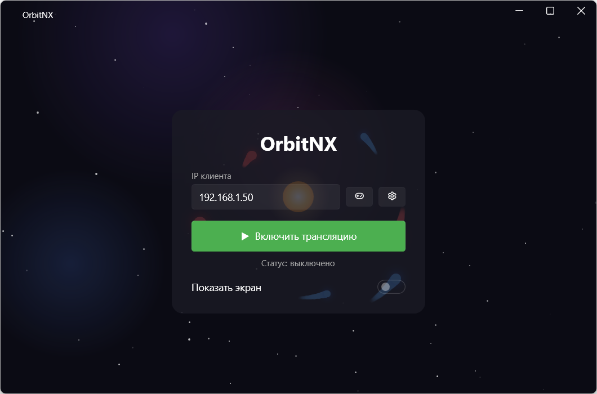
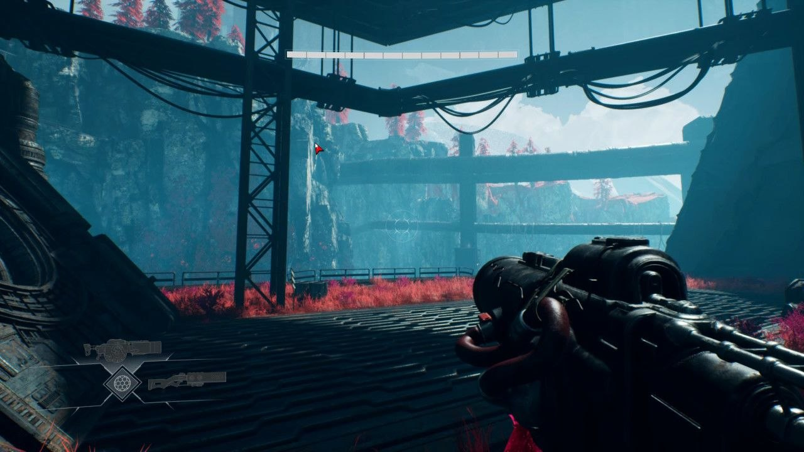
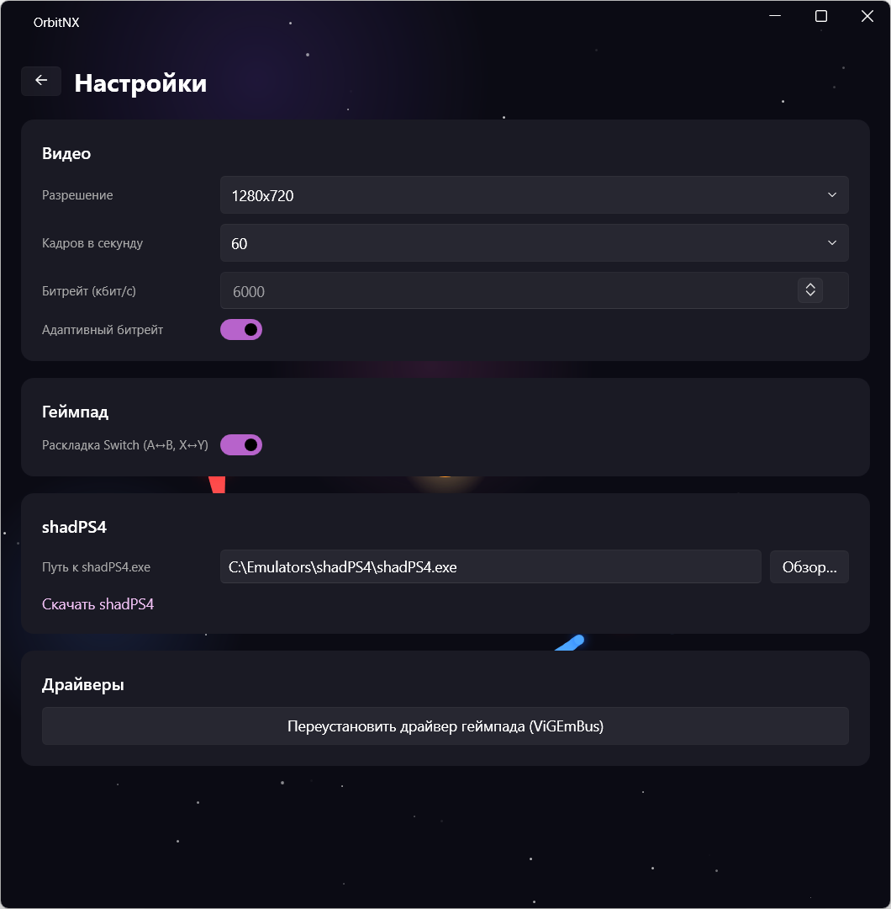
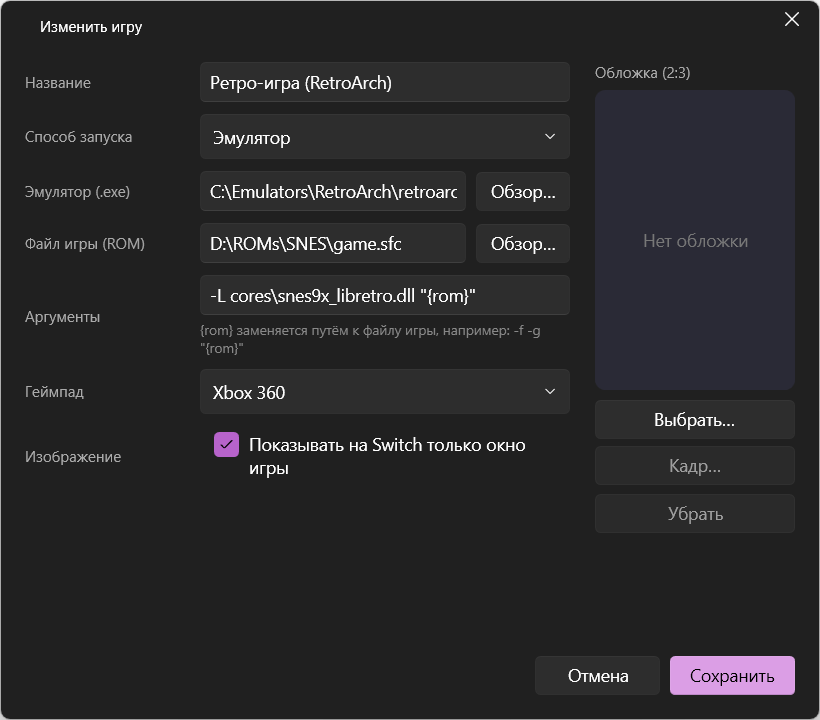

# Возможности OrbitNX

## Как это выглядит

OrbitNX работает в связке из двух устройств в одной сети: компьютер запускает игру и передаёт картинку
и звук, Switch показывает их и отправляет управление обратно.

```
        Компьютер (Windows)                              Nintendo Switch
 ┌─────────────────────────────┐                  ┌───────────────────────────┐
 │ OrbitNX                     │  видео + звук    │ OrbitNX для Switch        │
 │  • запускает игру           │ ───────────────▶ │  • показывает картинку     │
 │  • захватывает экран/окно   │                  │  • играет звук             │
 │  • виртуальный геймпад      │ ◀─────────────── │  • кнопки, стики,          │
 │  • библиотека игр           │   управление     │    сенсор, гироскоп        │
 └─────────────────────────────┘                  └───────────────────────────┘
```

### Пример: запуск игры из своей библиотеки

**1. На компьютере** — в OrbitNX указан IP-адрес Switch, трансляция включена.



**2. На Switch** — открыть OrbitNX и выбрать режим. IP-адрес консоли показан внизу экрана.


**3. «My games»** — выбрать игру из библиотеки, которую вы собрали на компьютере.


**4. Игра** — компьютер запускает игру, и она появляется на экране Switch. Управление — с Joy-Con или
Pro Controller.



Чтобы вернуться в меню, удерживайте «−» 3 секунды — игра на компьютере закроется. Если игру закрыть на
компьютере, Switch сам вернётся в меню.

## Приложение на компьютере

### Главный экран

- Поле **«IP клиента»** — адрес Switch (запоминается).
- **«Включить трансляцию»** / **«Выключить трансляцию»** — пока трансляция включена, OrbitNX ждёт
  Switch и подключается к нему автоматически, в том числе после обрывов связи.
- **Статус** — выключено / ожидание подключения / идёт трансляция (с названием режима).
- **«Показать экран»** — превью того, что сейчас передаётся.
- Кнопки **библиотеки игр** (геймпад) и **настроек** (шестерёнка).
- При закрытии окно сворачивается в трей; полностью программа закрывается через трей → «Выход».

### Настройки



- **Видео:** разрешение (640×360 — 1920×1080), частота кадров (24, 30, 45, 60), битрейт.
- **Адаптивный битрейт:** если на Switch теряются пакеты, OrbitNX снижает битрейт (не ниже
  1500 кбит/с), а после 30 секунд стабильной связи осторожно поднимает обратно до заданного значения.
- **Раскладка Switch:** меняет местами A/B и X/Y.
- **shadPS4:** путь к эмулятору (ищется автоматически) и ссылка на загрузку.
- **Драйверы:** переустановка ViGEmBus.

### Библиотека игр


Список ваших игр с обложками. Каждую можно изменить или удалить; изменения сразу уходят на Switch.




- **Четыре способа запуска:** обычная игра (`.exe` с аргументами и рабочей папкой), игра из Steam
  (выбор из установленных), эмулятор (с шаблоном аргументов `{rom}`), свой cmd-скрипт.
- **Тип геймпада** для каждой игры: Xbox 360 или DualShock 4 с гироскопом.
- **Захват только окна игры** — игра на весь экран Switch, даже если на компьютере она в окне.
- **Обложка** — любая картинка; для игр Steam подставляется автоматически.


- **Кадр обложки** — какую часть картинки показывать на Switch, с превью.

Подробнее — в [Библиотека игр](library.md).

### Что OrbitNX делает во время трансляции

**Режимы**
- **Steam** — запускает Steam (если не запущен) и открывает Big Picture. Следит за запуском и закрытием
  игр; после выхода из игры Steam сам возвращается в Big Picture. Если Big Picture закрыть на
  компьютере, сессия завершится.
- **shadPS4** — запускает эмулятор в режиме для геймпада.
- **Своя игра** — запускает её нужным способом и отслеживает её процесс, включая процессы, которые
  запустил лаунчер. Окну игры передаётся фокус, а захват переключается на это окно, даже если оно
  сменится (лаунчер → игра, смена разрешения).
- При отключении Switch или выходе в меню OrbitNX закрывает запущенную игру, выходит из Big Picture
  (сам Steam остаётся запущенным) или закрывает shadPS4.

**Видео**
- Захват основного монитора или окна игры через Windows.Graphics.Capture.
- Кодирование H.264 на видеокарте NVIDIA (NVENC) с минимальной задержкой; без NVIDIA — процессором.
- Если захват завис (бывает при переключении полноэкранного режима в играх), OrbitNX сам его
  перезапускает.

**Звук**
- Захватывается всё, что играет на устройстве вывода по умолчанию, и передаётся в Opus 128 кбит/с.

**Управление**
- До 4 виртуальных геймпадов Xbox 360 или DualShock 4 (драйвер ViGEmBus).
- Кнопка Steam / PS — сочетанием «−» + «+».
- Касания экрана Switch превращаются в касания на компьютере (в окне игры — с учётом его положения).
- Гироскоп и акселерометр — в режиме DualShock 4.

**Система**
- На время трансляции OrbitNX повышает свой приоритет и точность системного таймера, чтобы звук и видео
  не прерывались под нагрузкой игры.
- Отключает всплывающую панель Xbox Game Bar, которую Windows открывает при подключении геймпада.
- Не внедряется в процессы игр и не читает их память — это важно для игр с античитом.
- Если OrbitNX аварийно закроется, процесс кодирования видео завершится вместе с ним.

## Приложение на Switch

**Меню**
- Три плитки: Steam, shadPS4, «My games». IP-адрес консоли показан внизу экрана.
- «My games» — сетка обложек вашей библиотеки: A — играть, B — назад. Список приходит с компьютера
  автоматически и обновляется сам.

**Трансляция**
- Аппаратное декодирование видео; на экран всегда выводится самый свежий кадр, поэтому задержка не
  накапливается.
- Звук с маскировкой потерянных пакетов: короткие пропуски не слышны.
- После обрыва связи приложение само ждёт новое подключение.

**Управление**
- До 4 контроллеров: Joy-Con (вместе или по одному), Pro Controller, консоль в портативном режиме.
- Сенсорный экран и гироскоп.
- Удержание «−» 3 секунды — возврат в меню; закрыть приложение можно кнопкой «Домой».

**Запуск**
- Из Homebrew Menu или плиткой на главном экране (форвардер) — см. [Установка](installation.md).

## Ограничения

- Захватывается основной монитор компьютера (или окно игры).
- Switch выводит картинку в 1280×720; передавать больше обычно нет смысла.
- Свёрнутое окно игры не передаёт изображение; некоторые игры в эксклюзивном полноэкранном режиме
  видны только при захвате всего монитора.
- Курки ZL/ZR передаются как нажатие, без силы нажатия.
- Качество картинки зависит от Wi-Fi: лучше 5 ГГц и компьютер, подключённый к роутеру кабелем.
