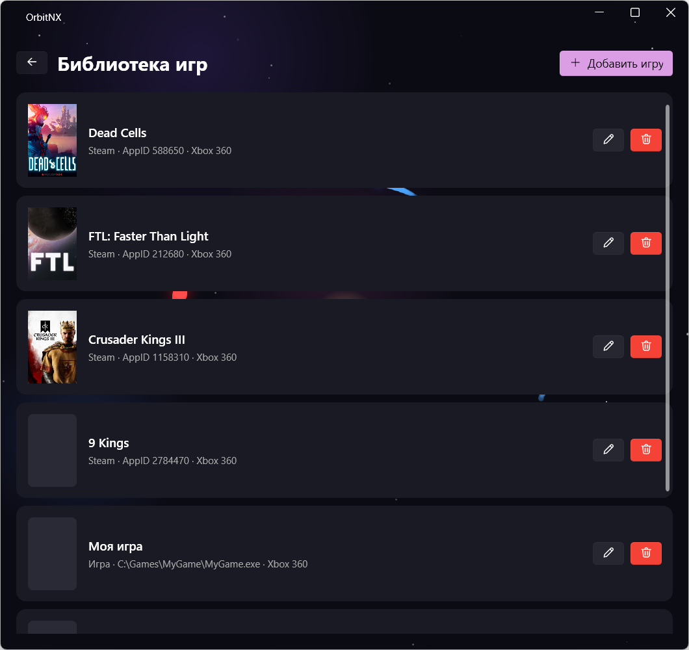
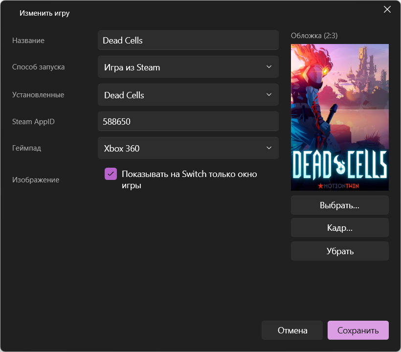
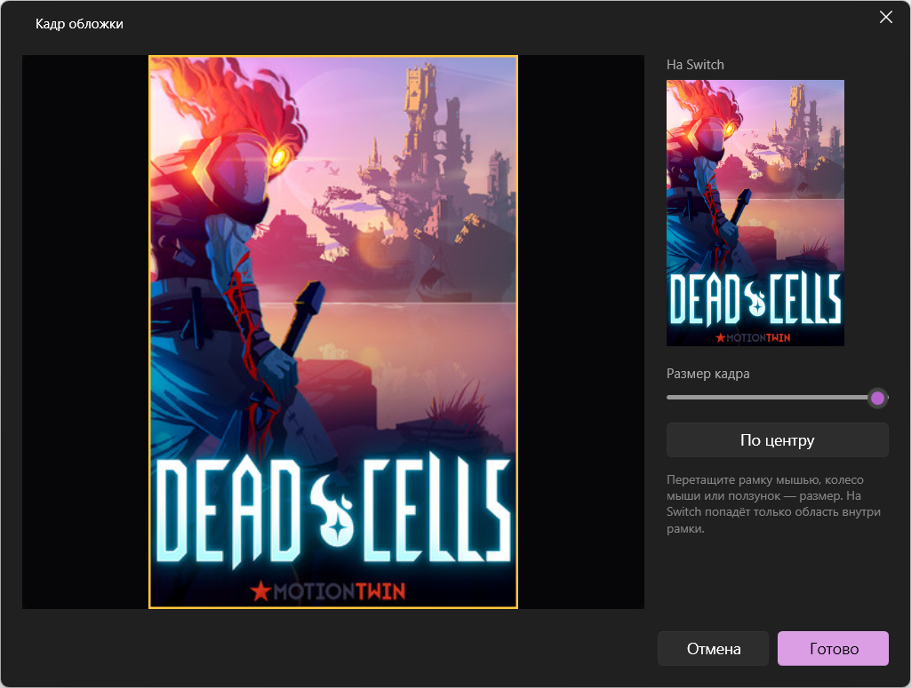
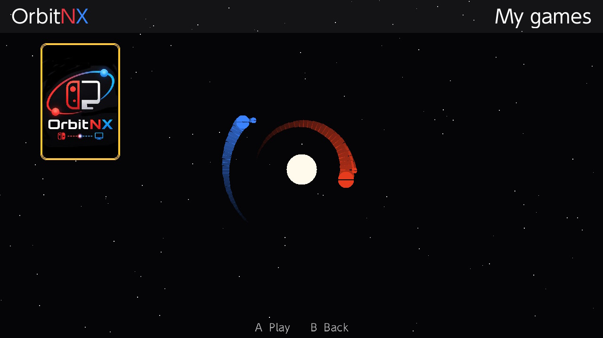

[Русский](library.md) | **English**

# Game library

Your own library lets you launch any PC game from the Switch, not only through Steam. The games appear
on the Switch, with covers, in the **My games** tile.

## Adding a game

On the OrbitNX main window, click the gamepad button (next to settings) → **«Добавить игру»**
(Add game).

### Launch methods

| Method | What to specify | How it starts |
|---|---|---|
| **Regular game (exe)** | the game file and, if needed, arguments and working folder | directly, without Steam |
| **Steam game** | pick from the list of installed games or enter the AppID | through Steam (`steam://rungameid/…`), with your Steam Input settings |
| **Emulator** | the emulator file, the game file (ROM) and arguments | the emulator with your game. In the arguments, `{rom}` is replaced with the game path, e.g. `-f -g "{rom}"` |
| **Custom script (cmd)** | commands, one per line | through `cmd.exe`, for anything the other methods don't cover |

If the game starts through a launcher (the launcher opens the game and then closes itself), that's
fine: OrbitNX also tracks processes started by the launcher.

### Gamepad

- **Xbox 360** suits most games.
- **DualShock 4 (with gyro)**, for when the game or emulator needs gyro.

### Picture

The **«Показывать на Switch только окно игры»** (Show only the game window on the Switch) checkbox is
on by default: only the game window is sent to the Switch, stretched to the whole console screen. The
game fills the Switch screen even if it runs in a small window on the PC, and other windows don't
cover it.

Clear the checkbox if the picture is black; this happens with some games in exclusive fullscreen
mode. The whole primary monitor is then sent instead.

## Covers

Click **«Выбрать…»** (Choose…) under the cover and pick any image. On the Switch, covers are shown
in a 2:3 ratio (like Steam library covers). For Steam games the cover is filled in automatically.

If the image has a different shape, the **«Кадр обложки»** (Cover framing) window opens: drag the
frame with the mouse and change its size with the mouse wheel or the slider. The right side shows how
the cover will look on the Switch. To return to the framing later, use the **«Кадр…»** (Frame…)
button.

This is how the library looks on the Switch:

## How it works during play

- Library changes reach the Switch automatically while streaming is on, even if the Switch is in the
  menu at that moment.
- When a game starts, OrbitNX gives its window focus so that input goes to the game. If the game
  switches windows (for example, launcher → the game itself), focus and capture move to the new
  window.
- When the game closes on the PC, the Switch returns to the menu.
- If you go back to the menu on the Switch (by holding − for 3 seconds), OrbitNX closes the game on
  the PC.

The library is stored in `library.json` next to OrbitNX, and covers in the `covers` folder.
